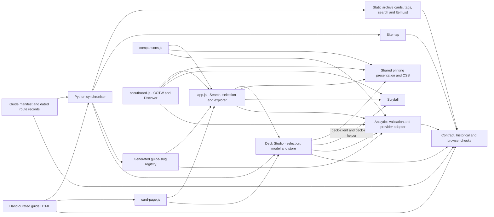

# ManaScout engineering stabilisation

## Baseline

The audit used `DEVELOPMENT` at `ba12866e98d89b87e9fbfb5d01fa6952ee9ba4ee` and fetched `main` at `fc779b94e8b4fd13d992f37a1c1448a7856cbead`. Both match the brief. The Phase 10.2 commit was unique to `DEVELOPMENT`, and four historical release merge commits were unique to `main`. The current branch model is recorded below. The static page and browser-local Deck Studio architecture is retained.

## Dependency map



## Backlog audit

| Item | Current implementation and duplication | Dependencies and regression risk | Independence and order |
| --- | --- | --- | --- |
| **A. Catalogue** | Before the patch, `app.js` owned a `GUIDE_SLUGS` set and `analytics.js` a second array. `card/index.html` independently listed routes in HTML and JSON-LD. `sitemap.xml`, directory snippets, Deck Studio copy and tests repeated membership or totals. Date evidence is spread through `docs/card-guide-research-3b.json`, `docs/us-search-baseline.json`, `docs/phase6-search-growth.json` and `docs/phase10-1-guides.json`. | `guideLink`, `deckLink` and public `guidePath` use the Search registry. Analytics uses its list for canonical paths and guide event enums. Incorrect membership can drop a handoff/event or emit a broken link. Sitemap dates and canonicals have separate SEO implications. | First in Prompt 1. Registry generation, tags and catalogue tests ship together. Historical research remains evidence. |
| **B. Taxonomy** | `card/index.html` previously encoded 58/63/67 tags on its archive anchors. Phase 10.2 tests expected an unclassified Hit It!. The category filter already combines those static tags with text search independently of the featured section. | Overly broad tagging makes a working filter return nearly everything. Changing assigned tags has low technical risk and directly affects collector relevance. | Prompt 1 after A. Review visible subsets, combined queries and count updates before adding future tags. |
| **C. Titles** | `app.js` wrote titles from home reset, named/exact load, printing-row selection and generic results. The first two checked guide context. `card-page.js` captured the editorial title and used a `MutationObserver` to repair writes. Deck Studio has its own static title and query-state robots directive. | Title writes interact with history, exact restore and guide selection. Guarding at the write boundary preserves static titles and removes the observer without changing URL or robots behavior. | Independently safe in Prompt 1 with a behavioral contract and a browser selection check. |
| **D. App responsibilities** | `app.js` couples `readJson`, named/exact lookup, history and URL generation, `submitSearch`, autocomplete, card/gallery rendering, printing pages and prices/FX, pick scoring, discovery, actions and a public bridge for `card-page.js`, `comparisons.js` and `scoutboard.js`. `search-intent.js` and `printing-presentation.js` already own parsing and semantic rendering boundaries. | The shared `generation` token, controllers, finish choices and archive state protect against late, conflicting results. Maintaining the existing public contract matters more than splitting by file length. | Partly independent. Prompt 2 extracts pure URL/intent and transport seams first, then moves stateful controllers behind the public bridge in later steps. |
| **E. Runtime CSS** | `installStyles` appended rules to `head` for compact results, selected actions and notices, archive controls and pagination, reversible card faces, and reduced motion. Related permanent layout rules already live in `printing-presentation.css`, site layout in `style.css`, and guide and comparison-specific rules in their own sheets. | Source order, breakpoint rules, focus rings and transform/compositing are the main risks. The new stylesheet carries the same declarations. The generic table-focus selector stays limited to pages that ran the injector. | Independently safe in Prompt 1 after title and asset-order checks. Compare computed styles and baseline images. |
| **F. Scryfall** | `app.js` has a 105ms pace, a 12s timeout/abort race, 429 cooldown using `Retry-After` and search-page validation. The same `readJson` also handles FX at a separate origin. `deck-client.js` serialises requests with 130ms spacing, races abort/timeouts, bounds a 16-entry TTL cache and has endpoint-specific validation, status and diagnostic handling. It reports 429 but has no shared cooldown. `deck-data.js:fetchPrinting` separately builds exact UUID requests and timeout/error messages. Repository call sites use the Deck client today, while this helper remains exported and tested. `scoutboard.js:getJson` checks the origin and credentials, shares in-flight promises in a 64-entry cache and evicts failed requests, without caller abort or shared pace/cooldown. Comparison exact restores call `ManaScout.comparison.exact`, backed by `app.js:cardId`. | Deck Studio has the strongest queue, bounded TTL cache, cancellation and exact-proof boundaries. Search provides the best existing cooldown. Copying either wrapper wholesale would duplicate UI policy or risk accepting incomplete/stale Deck verification. | Prompt 2 after transport contracts. Extract only the queue, safe URL handling, abort/timeout boundary and cooldown. Keep normalisation, freshness/proof, local snapshots and UI copy with callers. |
| **G. Asset versions** | All 68 guides refer to the same files through up to five versions of `guide-editorial.css`, three of `app.js`, and two each of analytics and the guide controller. Homepage, archive, Deck Studio and utility pages have separate query strings. Phase 10.2 updated two references on every guide for one shared asset pair. | HTTP caches can pair stale code with new dependencies. A runtime cache-busting fetch adds a failure mode, and an automatic Pages build change would affect release behavior. This phase adds one scoped stability suffix to changed shared dependencies. | Independently plan in Prompt 3. Trial deterministic content hashes in a staging copy with Pages-compatible paths, then seek approval before changing the actual publishing build. |
| **H. Tests** | `tests/run-deck-studio.py` and the GitHub workflow run the dependency-free Node files plus syntax and static Python validation. Browser suites and historical research ledgers carry separate snapshots. Several tests previously parsed the literal Search registration, hardcoded the live count or checked exact version query suffixes. | Replacing historical assertions with weak existence checks can hide regressions. Archived snapshots should protect decisions from their phase, and permanent contracts should protect current observable behavior. | Start in Prompt 1 with catalogue/title contracts. Add equivalent Search, exact explorer, comparison, physical card, Deck Studio, accessibility and canonical contracts before retiring duplicate historical assertions. |
| **I. Guide behaviors** | All 68 guides have one byte-identical inline search-toggle/keyboard/submit script. `card-page.js` separately creates the guide toolbar, listens for selection updates, controls the exact query and bootstraps the shared explorer. Page markup includes inline callback-free links, static fallbacks and special intent modules. | Extracting the duplicated header script is coherent, but native submit, Escape/focus return, inline URL target and no-JS access must survive all guide generations. A move should preserve preloaded exact selection and avoid double initialisation. | Prompt 4. Move the header behavior first, with broad browser coverage. Keep static prose, hero modules and exact reference markup in each guide. |
| **J. Performance** | Guide routes loaded six local JS files before this patch, including the 110KB app and 22KB comparison module. Guide bootstrap calls the explorer unless an existing matching `q` has started it. `app.js` prepares listeners and may load named/exact records, prices and the archive. Comparison mounts on `DOMContentLoaded` and observes its anchor subtree. The presentation engine delegates pointer input and pauses offscreen/reduced-motion effects. | Deferring guide loads blindly can hide canonical content or delay selecting a shared exact printing. Delaying comparison must still handle saved or shared comparisons as an initial state. Parsed size, extra requests, observer activity and CPU time have different tradeoffs on mobile. | Prompt 5 after seams and stable browser contracts. Measure cold/warm parse and execution with mobile throttling and track duplicate calls before introducing gated initialization. |
| **K. Analytics** | `analytics-config.js` is disabled, with a null provider. `analytics.js` projects bounded events, canonicalizes allowlisted paths and excludes raw query and deck state. Search, exact selection, printing-table selection and finish switch measure different steps. Comparison and Deck handoff use guide attribution. Product docs still describe earlier release snapshots that should stay historical. | Removing the wrong event can lose funnel granularity, and weakening canonical paths could expose arbitrary URL data. The generated registry supplies the existing allowlist. Utility pageviews continue through the separate fixed route allowlist. | Prompt 6, independent of transport refactors. Compare local debug events to actions once per intent, and use approved mocked provider tests before any activation. |
| **L. Branches** | Manual releases have used merge commits on `main`, leaving historical merge commits unshared with the next `DEVELOPMENT` work. `AGENTS.md` defines the development and optional backup branch boundaries. CI tests DEVELOPMENT pushes and main-targeted PRs. | Rebasing, resetting or force-pushing could discard approved work or invalidate references. Byte-identical trees can have different ancestry. | Documented in Prompt 1. Apply the fast-forward sequence below after a future manual release, before the next development commit. |

## Catalogue maintenance

`data/guides.json` is the only authored membership and classification list. Each entry has its slug, exact display name, one or more archive categories and the verified guide `lastmod`. The canonical URL is derived from the slug. The individual guide page and its archive-card summary, search terms and placement remain hand-edited.

For a new guide, create the page, add its archive card in the right section of `card/index.html` and add the manifest entry. Run:

```sh
python scripts/sync-guide-catalogue.py
python scripts/sync-guide-catalogue.py --check
```

The script supplies the archive tags, static counts and ItemList, shared slug registry, Deck Studio count and guide sitemap entries. An archive card without a manifest entry, missing content, duplicate archive route or invalid category fails the check. Guide sitemap updates use the documented editorial date. Existing non-guide sitemap entries retain independent lastmod dates. The archive sitemap date moves forward when a newer guide is added.

The runtime loads the small generated registry before Search and analytics. Archive classification is already available in the HTML. The site uses no catalogue fetch at runtime. The archive remains readable without JavaScript. Utility pages use fixed analytics routes, which remain independent of the guide registry.

### Taxonomy

| Category | Before | After | Evidence |
| --- | ---: | ---: | --- |
| Original Printings | 58 | 33 | The debut or earliest documented physical era matters to identifying or comparing a collector's copy. |
| Premium Treatments | 63 | 48 | A named special finish, serialization/headliner, or an identifiable collector-specific frame or release has substantive coverage. |
| Artwork & History | 67 | 35 | A relevant artist, artwork family, frame change or historical development informs a choice between versions. |

Hit It! uses Artwork & History because the regular #240 and extended-art #476 share Aaron J. Riley’s illustration but crop/frame it differently. The guide pairs that distinction with the printed-text and Oracle wording evidence. Its ordinary foil choices do not justify Premium Treatments.

Multi-category assignments are intentional. The groups below list all overlaps.

- **Original and Artwork:** Birds of Paradise, Black Lotus, Brainstorm, Command Tower, Enlightened Tutor, Gaea's Cradle, Grim Monolith, Lightning Bolt, Mox Diamond, Mystic Remora, Mystical Tutor, Swords to Plowshares, Worldly Tutor.
- **Original and Premium:** Ancient Tomb, Arcane Signet, Counterspell, Dark Ritual, Demonic Consultation, Dockside Extortionist, Force of Will, Heroic Intervention, Living Death, Lotus Petal, Mana Crypt, Mana Drain, Necropotence, Rhystic Study, Sensei's Divining Top, Skullclamp.
- **Premium and Artwork:** Deep Space 9, Doubling Season, Jace, the Mind Sculptor, Jeska's Will, Lightning Greaves, Orcish Bowmasters, Sheoldred, the Apocalypse, The Great Henge, The Theorist, Jace Beleren, Thoughtseize, Urza's Saga.
- **All three:** Demonic Tutor, Mana Vault, Reanimate, Sol Ring.

## Measurements

The byte counts compare the fetched starting tree with the working result. The script payload totals count unique first-party external JS files linked from a page. Gzip is an estimate using local compression. Parse/execution timings and deployed network behavior are separate measurements.

| Surface or measure | Before | After |
| --- | ---: | ---: |
| `app.js` bytes | 109,953 | 100,417 |
| `card-page.js` bytes | 11,961 | 11,029 |
| `analytics.js` bytes | 10,497 | 9,390 |
| Generated registry JS bytes | 0 | 1,760 |
| `printing-presentation.css` bytes | 14,354 | 20,999 |
| `style.css` + `guide-editorial.css` + `comparisons.css` bytes | 70,815 | 70,815 |
| Guide scripts, count / raw / estimated gzip | 6 / 170,311 / 47,726 | 7 / 160,496 / 45,020 |
| Homepage scripts, count / raw / estimated gzip | 7 / 203,410 / 57,092 | 8 / 194,527 / 54,624 |
| Archive scripts, count / raw / estimated gzip | 3 / 26,150 / 9,239 | 4 / 26,803 / 9,554 |
| Deck Studio scripts, count / raw / estimated gzip | 21 / 367,854 / 113,853 | 22 / 368,507 / 114,168 |
| Authored runtime guide lists | 2 | 0 |
| Generated runtime guide lists | 0 | 1 |
| Authoritative infrastructure catalogues | 0 | 1 |
| Manually edited production paths in the ordinary new-guide workflow | 6 | 3 |
| Production files edited manually solely to increment a count | 1 | 0 |

The six baseline authoring paths are the new guide, archive, sitemap, app registry, analytics registry and Deck Studio count. The three new authoring paths are the guide, its archive entry and manifest. Four derived outputs may change on disk, with the archive counted in both sets. Deck Studio remains the sole count-only output in that scenario. Static public counters still appear in two HTML documents and are generated consistently. Historical safeguards compare original guide-cohort records and dates. The permanent contract calculates current membership and counts from the manifest.

A scratch addition confirmed that all four outputs update after the three authoring changes. A separate Chromium sample used three cold navigations at 390px with a local uncompressed server and captured catalogue responses. Median first-party JS transfers were 205,510 to 196,927 bytes on the homepage and 172,111 to 162,596 bytes on Mr. Spock. Decoded JS matched the raw values in the table. Reported script time ranged from 21.6 to 93.0ms across those runs. A controlled timing baseline, cold/warm cache and real mobile device measurements belong in the performance phase.

## Ordered next work

1. **App decomposition.** Add history/URL tests for direct lookup, back/forward, clearing and robots behavior. Move pure parsing and link helpers first. Preserve the `window.ManaScout` interface while moving search and explorer controllers separately. Use the existing `search-intent.js` and printing presentation modules where appropriate.
2. **Scryfall transport.** Use the Deck client's cancellation/queue boundary and Search's validated 429 policy as the starting point. Cover queued abort, JSON-reader timeouts, numeric and HTTP-date `Retry-After`, bounded cache eviction and rejecting mismatched origin/pagination URLs. Migrate one readonly Search endpoint first, then cover comparison exact restore, Scoutboard, and Deck's data compatibility helper. Move Deck Studio reads only after proof and stale-result contracts pass. Keep FX outside the transport.
3. **Asset versioning.** Audit a dry-run deterministic hash utility on a staging tree. Verify script order and cache freshness with both cold and warm navigation. Keep branch and GitHub Pages publishing unchanged until the staging approach passes and the owner selects a release integration.
4. **Permanent contracts.** Establish behavior suites for Search, printing explorer, physical surfaces, comparison, Deck Studio, accessibility and canonical behavior. Archive or retire a duplicate phase assertion only after mapping its behavior to a live equivalent. The old Phase 6.1 browser harness still asserts an earlier COTW sheen selector at its first foil step. It reproduces on the starting tree and is useful evidence for fixture separation.
5. **Guide behavior.** Share the identical header-search logic while retaining keyboard and no-JS navigation. Verify current guide markup generations and deferred script order before extracting explorer glue.
6. **Performance.** Measure cold navigation, script execution and Scryfall request counts on representative mobile and desktop routes. Defer comparison/subtree observation only when the initial route has no saved/shared state. Consider deferring secondary printings work after the static or selected reference is usable.
7. **Analytics readiness.** Use the local debug adapter to check event frequency and canonical source dimensions. Production enablement depends on the owner registering or confirming `manascout.co.uk` in the Plausible account, updating the privacy disclosure, enabling the existing public domain configuration through a release and creating the named goals. The browser configuration requires no credentials. Leave production disabled pending that work.
8. **Releases.** Synchronise DEVELOPMENT after each future manual release, before beginning new work. Keep the release branch and optionally authorised backup branch operations separate.

## Safe post-release synchronisation

Once the owner has merged a manual release to `main`, make sure the working tree is clean and check that the merged release contains the current development head. The following sequence only fast-forwards the development ref.

```sh
git fetch origin refs/heads/main:refs/remotes/origin/main refs/heads/DEVELOPMENT:refs/remotes/origin/DEVELOPMENT
git switch DEVELOPMENT
git status --short
git merge --ff-only origin/DEVELOPMENT
git merge-base --is-ancestor HEAD origin/main
git merge --ff-only origin/main
git push origin HEAD:refs/heads/DEVELOPMENT
git ls-remote origin refs/heads/main refs/heads/DEVELOPMENT
```

Stop if the worktree is dirty, the ancestry check fails, or a fast-forward is unavailable. Inspect the two ranges with `git log --left-right origin/main...DEVELOPMENT`. If unreleased changes remain, the owner can review a normal reconciliation on DEVELOPMENT that preserves both histories. Once authorised, recheck before updating the backup branch through its own verified fast-forward. This phase left the existing branch ancestry intact.
